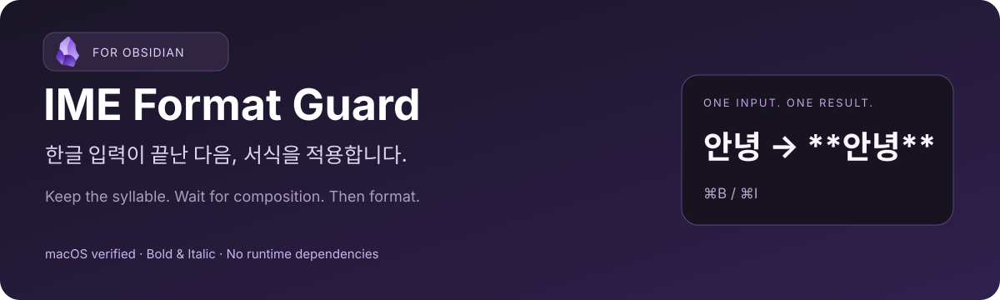

<p align="center"></p>

# IME Format Guard

Wait for IME composition to finish before applying **bold** or *italics* in Obsidian.

[한국어](README.md) · [Installation](#installation) · [Testing](docs/TESTING.md) · [Issues](https://github.com/Go-Jinhan/obsidian-ime-format-guard/issues)

> Early public release. Not yet listed in the Obsidian Community directory. Developed for a reproduced Korean input issue on macOS; compatibility with other operating systems and IMEs has not been verified.

## The problem

A final Hangul syllable may still be composing even though it is already visible. Applying formatting before the input method commits it can produce an extra character:

```text
Expected: 안녕 → Cmd+B → **안녕**
Observed: 안녕 → Cmd+B → **안녕**녕
```

| Before | After |
| :---: | :---: |
|  |  |

These are actual Obsidian editor captures of a disposable test note, using automated composition → formatting → commit input. They contain no personal notes. Markdown delimiters can remain visible on the active editing line.

## How it works

The plugin wraps Obsidian's existing bold and italic command callbacks. If the editor is not composing, the command runs immediately. Otherwise, it waits for the real `compositionend` event, then runs the original command after that event has been processed.

It does not guess which characters are duplicates, delete repeated syllables, blur the editor, block keyboard input, or synthesize composition events. Intentional repetition such as `녕녕` is preserved.

A **1.5-second timeout cancels** a command if composition never completes; it is not a fixed formatting delay. If the user changes editor or file, or the editor loses focus before the deferred command runs, the command is cancelled. Additional formatting requests while one is pending are ignored; apply another style after the first completes.

## Installation

1. Download `main.js` and `manifest.json` from [Releases](https://github.com/Go-Jinhan/obsidian-ime-format-guard/releases). If no release is available yet, use both files from the same repository revision; no build is required.
2. Put them in `<vault>/.obsidian/plugins/ime-format-guard/`.
3. Restart Obsidian or refresh the plugin list.
4. Enable **IME Format Guard** in **Settings → Community plugins**.
5. Try Korean input followed immediately by Cmd+B and Cmd+I in a test note.

No `styles.css` or configuration file is needed. Disable the earlier private **Local IME Format Guard** before enabling this version. Community-directory search installation is not available yet.

## Usage

Keep using your existing bold and italic shortcuts. Custom shortcuts attached to those same built-in commands are also covered. Other formatting commands, including highlight, inline code and links, are outside the scope of this version.

If the timeout notice appears, press Right Arrow to commit the composition, then retry the formatting command. Report persistent problems using the [issue form](https://github.com/Go-Jinhan/obsidian-ime-format-guard/issues/new?template=bug_report.yml).

Disable the plugin to restore the original command callbacks. Formatting already applied remains ordinary Markdown in the note; normal Obsidian undo can revert it.

## Compatibility

| Item | Evidence / scope |
| --- | --- |
| Verified app | Obsidian 1.14.5, installer 1.14.4 |
| Original issue | Korean IME composition with bold/italic on macOS |
| Physical-keyboard confirmation | Initial local implementation 0.3.0, confirmed by the affected user |
| Public implementation | 0.3.1: 14 automated tests and an actual-editor automated bold reproduction |
| Minimum version | 1.14.5; older versions have not been verified |
| Windows, Linux, other IMEs | Not verified |
| Mobile | Not supported (`isDesktopOnly: true`) |

This plugin accesses internal command callbacks and `editor.cm`. Obsidian updates and other plugins wrapping the same commands may affect compatibility. It is a narrow workaround, not a general fix for every Korean/CJK editing issue. Public 0.3.1 adds cancellation checks for focus and file changes to the working local implementation.

## Privacy

No network requests, accounts, telemetry or note-content collection. The plugin does not directly write vault files or alter hotkey configuration. It invokes the existing formatting command requested by the user. Its command wrappers, event listeners and timers are cleaned up on unload.

## Development

Node.js 22+ is required for the development scripts. There are no runtime or development dependencies to install and no bundling step: root `main.js` is the release code.

```sh
npm test
npm run check
npm run package
```

Packaging copies `main.js` and `manifest.json` into `dist/ime-format-guard/` after checks pass. Automated tests cover ordering, cancellation and cleanup; they do not replace real OS IME testing.

- [Testing and reproduction notes](docs/TESTING.md) — Korean
- [Release procedure](docs/RELEASING.md) — Korean
- [Changelog](CHANGELOG.md)
- [Contributing](CONTRIBUTING.md) — Korean

## License and attribution

Project code is [MIT-licensed](LICENSE). Obsidian's name and application UI belong to their respective rights holders. Screenshots use test data; the banner and flow diagram were created for this project. The banner includes the official Obsidian mark in its original colors and proportions; the mark is not covered by this repository’s MIT license. See [image attribution](docs/assets/ATTRIBUTION.md). This is an independent project, not an official or endorsed Obsidian product.

See the [official submission guide](https://docs.obsidian.md/Plugins/Releasing/Submit%20your%20plugin). A [related forum report](https://forum.obsidian.md/t/pressing-esc-to-exit-while-in-suggest-modal-will-move-last-korean-character-to-editor/100910) concerns trailing Korean input in a different interaction; it does not establish that the bugs have the same cause.
