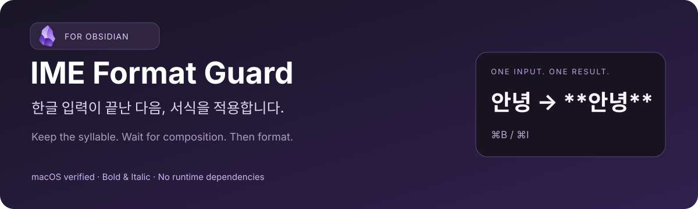
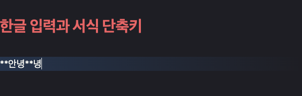
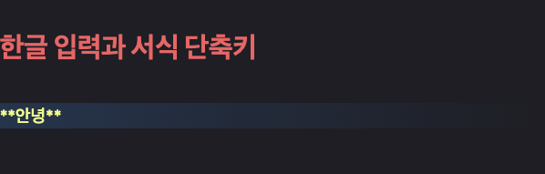
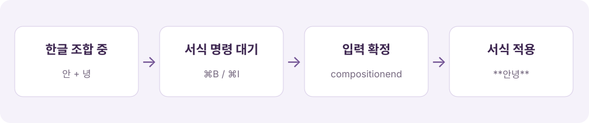

<p align="center">
  
</p>

<p align="center">
  <strong>한글을 쓰고 바로 ⌘B·⌘I를 눌렀을 때, 마지막 글자가 한 번 더 붙는 문제를 위한 Obsidian 플러그인.</strong>
</p>

<p align="center">
  <a href="README.en.md">English</a> ·
  <a href="#설치">설치</a> ·
  <a href="#사용법">사용법</a> ·
  <a href="#지원-범위와-제약">지원 범위</a> ·
  <a href="docs/TESTING.md">테스트 기록</a> ·
  <a href="https://github.com/Go-Jinhan/obsidian-ime-format-guard/issues">문제 신고</a>
</p>

> **배포 상태:** 초기 공개 버전입니다. Obsidian 커뮤니티 플러그인 목록에는 아직 등록되지 않았습니다. macOS 한글 입력에서 발견하고 검증한 문제를 다루며, 모든 입력기·운영체제에서의 해결을 보장하지 않습니다.

## 어떤 문제를 해결하나요?

Obsidian에서 `안녕`을 입력한 직후 **굵게 (`⌘B`)** 또는 **기울임 (`⌘I`)**을 적용하면, 마지막 글자가 서식 밖이나 안에 한 번 더 붙는 문제가 발생할 수 있습니다.

```text
입력 의도    안녕 → ⌘B → **안녕**
관찰한 문제  안녕 → ⌘B → **안녕**녕
```

화면에 글자가 보여도 한글 입력기는 마지막 음절을 아직 조합하고 있을 수 있습니다. 조합 중인 문서에 서식을 먼저 적용하면, 뒤늦게 확정되는 입력이 다시 들어올 수 있습니다. 이 플러그인은 **그 순서를 바꿉니다.**

## 실제 Obsidian에서의 전후 비교

| 적용 전 — 마지막 글자가 한 번 더 입력됨 | 적용 후 — 입력한 글자만 유지됨 |
| :---: | :---: |
|  |  |

*개인 노트가 없는 별도 테스트 노트의 실제 Obsidian 편집기 화면입니다. 조합 입력 → 굵게 명령 → 입력 확정 순서를 자동으로 전달했습니다. 커서가 있는 편집 줄에서는 마크다운 기호가 보일 수 있습니다. 환경과 검증 방법은 [테스트 기록](docs/TESTING.md)에 구분해 두었습니다.*

## 어떻게 동작하나요?



1. 기본 **굵게·기울임 명령**이 실행될 때 입력기의 조합 상태를 확인합니다.
2. 조합 중이 아니면 원래 명령을 즉시 실행합니다.
3. 조합 중이면 `compositionend` 이벤트를 기다립니다.
4. 해당 이벤트 처리가 끝난 다음, 원래 서식 명령을 한 번 실행합니다.

일정 시간마다 텍스트를 검사하거나 중복 글자를 추측해서 삭제하지 않습니다. `녕녕`처럼 의도적으로 반복한 글자는 그대로 유지됩니다. 포커스를 강제로 옮기거나 가짜 조합 종료 이벤트를 보내지도 않습니다.

**1.5초는 동작 지연이 아니라 취소 기한입니다.** 그 안에 조합이 끝나지 않으면 대기 중인 서식 명령을 취소하고 안내합니다. 정상적인 경우에는 입력 확정 직후 실행됩니다.

## 설치

현재는 수동으로 설치할 수 있습니다. 커뮤니티 목록에서 이름을 검색하는 설치 방식은 아직 지원되지 않습니다.

1. [GitHub Releases](https://github.com/Go-Jinhan/obsidian-ime-format-guard/releases)에서 릴리스가 제공되는 경우 `main.js`와 `manifest.json`을 내려받습니다. **릴리스가 아직 없다면** 이 저장소 루트의 두 파일을 같은 버전으로 내려받아도 됩니다. 별도 빌드가 필요 없습니다.
2. 볼트 안에 다음 폴더를 만들고 두 파일을 넣습니다.

   ```text
   <vault>/
   └── .obsidian/
       └── plugins/
           └── ime-format-guard/
               ├── main.js
               └── manifest.json
   ```

3. Obsidian을 다시 시작하거나 플러그인 목록을 새로고침합니다.
4. **설정 → 커뮤니티 플러그인 → IME Format Guard**를 활성화합니다.
5. 별도 테스트 노트에서 한글 입력 직후 `⌘B`와 `⌘I`를 각각 확인합니다.

`styles.css`나 별도 설정 파일은 필요하지 않습니다. 기존의 개인용 **Local IME Format Guard**를 사용했다면 먼저 비활성화하세요. 두 버전을 동시에 활성화할 필요가 없습니다.

## 사용법

활성화한 뒤 평소처럼 입력하면 됩니다. 별도 명령 실행이나 단축키 재설정이 필요 없습니다.

| 하고 싶은 일 | 사용 방법 |
| --- | --- |
| 한글 단어를 굵게 표시 | 한글 입력 직후 기존 굵게 단축키 사용 |
| 한글 단어를 기울임으로 표시 | 한글 입력 직후 기존 기울임 단축키 사용 |
| 선택한 텍스트에 서식 적용 | 기존 Obsidian 동작 그대로 |
| 다른 키로 서식 명령 실행 | 같은 기본 명령에 연결된 사용자 단축키도 적용 대상 |
| 플러그인 사용 중단 | 설정에서 비활성화하면 원래 명령으로 복원 |

### 알림이 뜨는 경우

“한글 입력이 아직 확정되지 않았습니다”라는 알림이 뜨면 대기 중인 서식 명령이 취소된 상태입니다. 오른쪽 방향키로 입력을 확정한 뒤 다시 적용해 보세요. 반복된다면 [문제 신고](https://github.com/Go-Jinhan/obsidian-ime-format-guard/issues/new?template=bug_report.yml)에 재현 환경을 남겨 주세요.

대기 중 다시 누르는 서식 명령은 추가로 예약하지 않습니다. 한 번 적용된 뒤 다음 서식을 사용하세요. 기다리는 동안 다른 편집기·파일로 이동하거나 편집기에서 포커스가 빠지면 적용을 취소합니다.

## 지원 범위와 제약

| 항목 | 현재 범위 |
| --- | --- |
| 확인한 앱 | Obsidian **1.14.5**, 설치 프로그램 **1.14.4** |
| 확인한 문제 | macOS 한글 조합 중 굵게·기울임 적용 시 마지막 글자 중복 |
| 실제 키보드 확인 | 초기 로컬 구현 0.3.0에서 사용자 확인 |
| 공개 코드 확인 | 0.3.1에서 자동 테스트 14개 및 실제 편집기 자동 재현 검사 |
| 최소 앱 버전 | 1.14.5 — 그 이전 버전의 호환성을 주장하지 않음 |
| Windows·Linux 및 다른 IME | 미검증 |
| 모바일 | 지원하지 않음 (`isDesktopOnly: true`) |
| 하이라이트·링크·코드 서식 등 | 이번 수정 대상이 아님 |

**호환성 주의:** 기본 명령 콜백과 `editor.cm` 등 내부 구현에 접근합니다. Obsidian 업데이트나 같은 서식 명령을 수정하는 다른 플러그인과의 조합에 따라 동작이 달라질 수 있습니다. 문제가 생기면 이 플러그인을 비활성화해 비교해 주세요. 앱 전체의 한글 입력 문제를 해결하는 범용 패치는 아닙니다.

## 개인정보와 데이터

- 네트워크 요청, 계정 연결, 분석·텔레메트리 기능이 없습니다.
- 노트 전체를 읽거나 내용을 수집·전송하지 않습니다.
- 볼트 파일을 직접 쓰거나 일괄 수정하지 않습니다. 사용자가 실행한 기존 서식 명령을 적절한 시점에 호출합니다.
- 단축키 설정 파일을 변경하지 않습니다.
- 비활성화하면 자신이 설치한 명령 래퍼를 해제하고 대기 중인 이벤트·타이머를 정리합니다.

이미 적용한 굵게·기울임은 일반 마크다운이므로 플러그인을 제거해도 노트에 남습니다. 필요하면 Obsidian의 실행 취소를 사용하세요.

## 개발 및 검증

런타임 의존성과 번들링 단계가 없는 작은 CommonJS 플러그인입니다. 저장소 루트의 `main.js`가 실제 배포 코드입니다.

```sh
# Node.js 22 이상. npm install은 필요하지 않습니다.
npm test          # 조합·서식 순서와 정리 동작 검사
npm run check     # 문법과 배포 메타데이터 검사
npm run package   # 검사 후 dist/ime-format-guard/에 배포 파일 복사
```

자동 테스트는 명령 실행 순서·취소·복원 등을 검사하며 실제 운영체제 IME 테스트를 대신하지 않습니다. 실제 편집기 재현 절차는 [TESTING](docs/TESTING.md), 변경 내역은 [CHANGELOG](CHANGELOG.md), 공개 절차는 [RELEASING](docs/RELEASING.md)를 참고하세요.

## 자주 묻는 질문

**모든 맥 사용자에게 필요한가요?**

아닙니다. 한글 조합 중 서식 명령을 실행했을 때 중복이 발생하는 환경을 위한 보정입니다. 증상이 없다면 설치할 필요가 없습니다.

**왜 중복 글자를 찾아 지우지 않나요?**

의도적으로 같은 글자를 연속 입력한 경우와 구분하기 어렵기 때문입니다. 이 플러그인은 글자를 삭제하는 대신 입력 확정과 서식 적용 순서를 조정합니다.

**다른 한글·CJK 서식 플러그인과 같은 기능인가요?**

굵게가 화면에 표시되지 않는 마크다운 렌더링 문제와, 글자가 실제로 한 번 더 입력되는 문제는 다릅니다. 이 프로젝트는 후자를 대상으로 합니다.

**Obsidian에서 공식 제작하거나 승인한 플러그인인가요?**

아닙니다. 독립 커뮤니티 프로젝트이며 현재 커뮤니티 목록 등록 전입니다.

## 라이선스와 출처

프로젝트 코드는 [MIT License](LICENSE)로 공개합니다. Obsidian의 이름과 앱 UI는 해당 권리자의 자산입니다. 전후 이미지는 테스트 데이터를 사용한 실제 앱 화면이고, 배너와 흐름도는 이 프로젝트용으로 제작한 설명 이미지입니다. 배너에는 [공식 Obsidian 마크](https://obsidian.md/brand)를 원래 색상과 비율로 사용했습니다. 로고에는 이 저장소의 MIT 라이선스가 적용되지 않으며, 공식 제품이나 공식 승인을 의미하지 않습니다. [이미지 출처](docs/assets/ATTRIBUTION.md)를 참고하세요.

- [Obsidian 공식 플러그인 제출 안내](https://docs.obsidian.md/Plugins/Releasing/Submit%20your%20plugin)
- [플러그인 개발자 정책](https://docs.obsidian.md/community-directory/developer-policies)
- [한글 조합 중 마지막 글자가 본문에 들어오는 관련 포럼 사례](https://forum.obsidian.md/t/pressing-esc-to-exit-while-in-suggest-modal-will-move-last-korean-character-to-editor/100910) — **다른 동작에서 발생한 유사 사례**이며, 이 프로젝트와 동일한 버그라는 뜻은 아닙니다.
